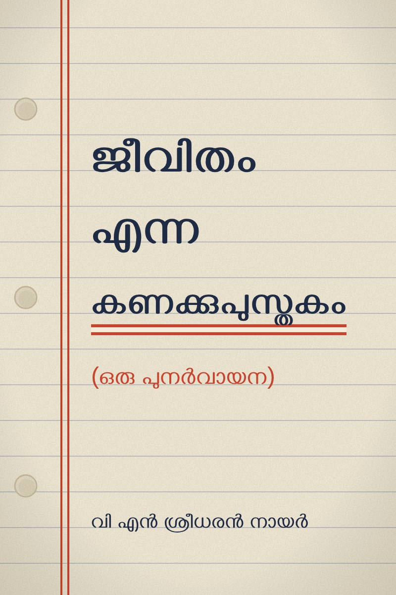
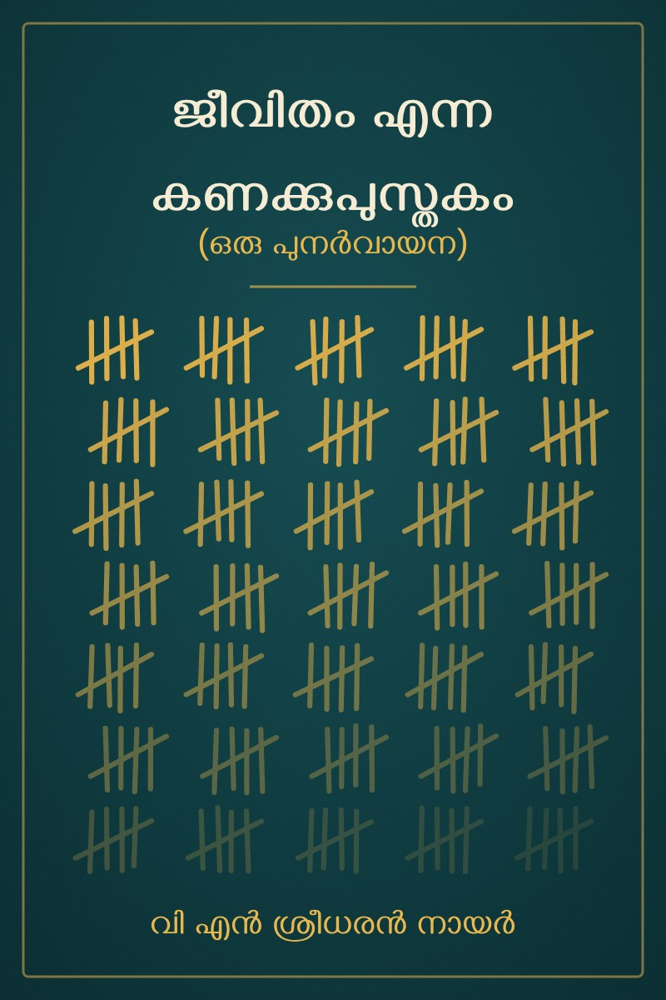

<!-- 
# കാലത്തിന്റെ കണക്കുപുസ്തകം
## (ഒരു പുനർവായന) -->

# ജീവിതം എന്ന കണക്കുപുസ്തകം 

## (ഒരു പുനർവായന)

--- 

വി എൻ ശ്രീധരൻ നായർ 

<!-- Covers: choose which one shows with the COVER constant at the top of book-extras.js -->

