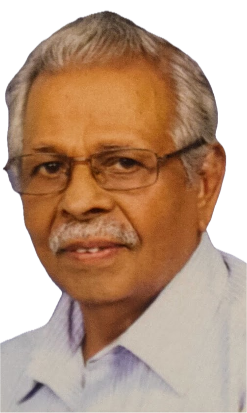

# ഗ്രന്ഥകർത്താവിനെക്കുറിച്ച്

## വി എൻ ശ്രീധരൻ നായർ

Educated at
- St. Joseph's High School, Angamaly,
- U C College, Aluva,
- Govt. Engineering College, Thrissur,
- School of Management Studies, Cochin University of Science and Technology and
- Annamalai University.

After 34 years of service, retired as Head of the Department of Human Resource Management of HMT Ltd., Kalamassery.

Life Member of the Institution of Engineers (India) Fellow of the National Institute of Personnel Management.

### പ്രസിദ്ധീകരിച്ച പുസ്തകങ്ങൾ
- അനുഭവം ഗുരു  
- മൗനം ഭവതി വാചാലം
- ദാനം കിട്ടിയ ജന്മങ്ങൾ

